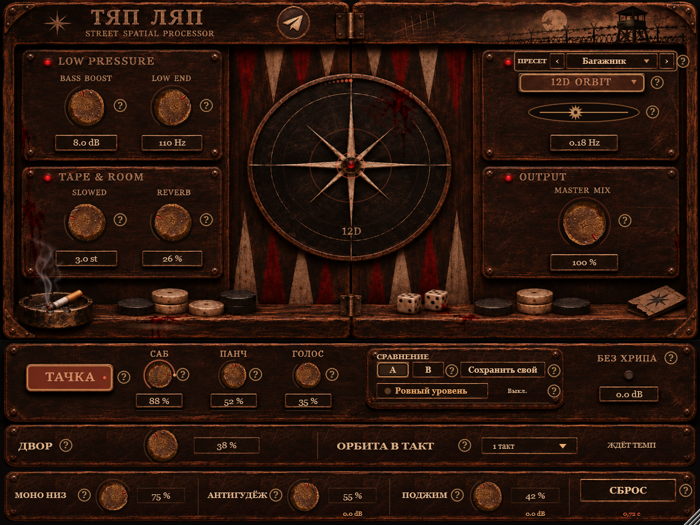

# Тяп Ляп

«Тяп Ляп» — эффект для жирного автомобильного баса, slowed + reverb и движущегося стереозвука. Интерфейс сделан в виде потёртого деревянного аппарата с живой сценой: вещи на полке подпрыгивают от ударов, а роза ветров при сильном низе превращается в сабвуфер с аудиореактивной мембраной.



## Форматы

| Система | Форматы | Архитектура |
| --- | --- | --- |
| Windows 10/11 | VST3, Standalone | x64 |
| macOS 11+ | VST3, Audio Unit, Standalone | Universal: Apple Silicon + Intel |

На macOS Audio Unit предназначен для Logic Pro и GarageBand. VST3 работает в FL Studio, Ableton Live, Reaper и других совместимых программах.

## Возможности

- **Bass Boost / Low End** — низкая полка до +18 dB с выбором частоты 35–220 Гц.
- **Slowed** — понижение высоты в реальном времени до 12 полутонов без изменения темпа проекта.
- **Reverb** — стереореверберация с плавным хвостом.
- **12D Orbit** — движение между каналами с equal-power панорамой, Haas-задержкой и модуляцией глубины; есть синхронизация с темпом.
- **Тачка** — отдельные ручки «Саб», «Панч» и «Голос» для автомобильной системы.
- **Двор** — имитация музыки из машины на расстоянии.
- **Моно низ**, **Антигудёж** и **Поджим** — контроль низа, резонанса и динамики.
- **Без хрипа** — выходной лимитер до −1 dBFS.
- **Сброс** — tape-stop на 0,72 секунды с автоматическим возвратом.
- Фабричные и пользовательские пресеты, A/B-сравнение и выравнивание громкости.
- Русские подсказки «?» для каждого основного регулятора.
- Аудиореактивные анимации, включая сабвуфер, дым, свет, кости и фишки.
- Кнопка Telegram: [t.me/shur2016](https://t.me/shur2016).

## Установка на macOS

В Release доступны два варианта:

- `.pkg` устанавливает VST3 и AU в системные папки;
- `.zip` содержит оба готовых bundle для ручной установки.

Пути ручной установки:

```text
/Library/Audio/Plug-Ins/VST3/Tyap Lyap.vst3
/Library/Audio/Plug-Ins/Components/Tyap Lyap.component
```

Текущий открытый пакет имеет ad-hoc подпись и не нотариализирован Apple. Если Gatekeeper не разрешает открыть `.pkg`, установите bundle из ZIP вручную. После установки перезапустите DAW и повторно просканируйте плагины.

## Установка на Windows

Запустите `Tyap-Lyap-2.2-Setup-x64.exe`. Установщик найдёт старую версию, сохранит резервную копию и обновит VST3. Для ручной установки скопируйте всю папку `Tyap Lyap.vst3` в:

```text
C:\Program Files\Common Files\VST3\
```

После этого в FL Studio откройте **Options → Manage plugins → Find installed plugins**.

## Сборка на macOS

Требуются Xcode Command Line Tools, CMake 3.22+ и интернет для первой загрузки JUCE 8.0.12.

```bash
bash scripts/build-macos.sh
```

Скрипт собирает Universal Binary `arm64 + x86_64`, VST3, AU и Standalone, запускает DSP-тесты на 44,1/48/96 кГц, проверяет подписи и создаёт `.pkg` и `.zip` в `dist-macos`.

## Сборка на Windows

Требуются Visual Studio 2022/2026 с Desktop development with C++, CMake и Windows SDK.

```powershell
cmake -S . -B build -A x64
cmake --build build --config Release
```

## Проверки

Репозиторий содержит тесты стереоорбиты, параметров, состояния проектов, пресетов, лимитера, level match и VST3-хоста. GitHub Actions на macOS собирает обе архитектуры и прикладывает готовые пакеты к Release по тегу `v*`.

## Безопасная громкость

Усиление баса и пространственная обработка могут заметно поднять пики. Начинайте с пониженной громкости канала, особенно в наушниках.

## JUCE

Проект использует JUCE 8.0.12. JUCE доступен по AGPLv3 или коммерческой лицензии JUCE; при распространении своей сборки соблюдайте выбранные условия лицензии.
